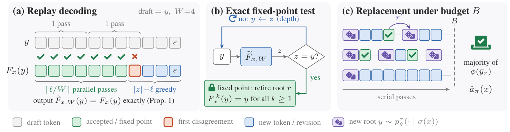
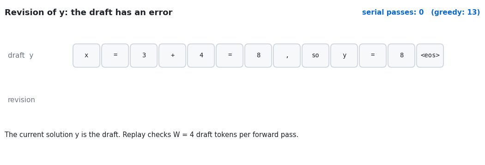
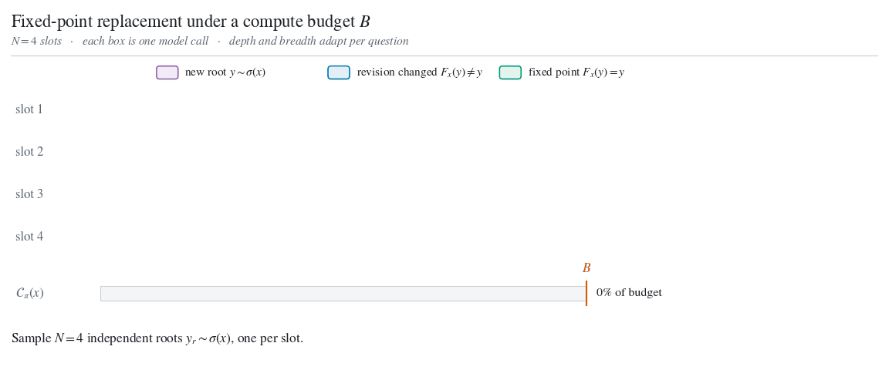
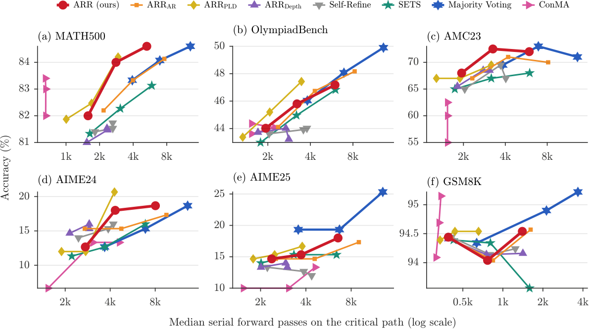
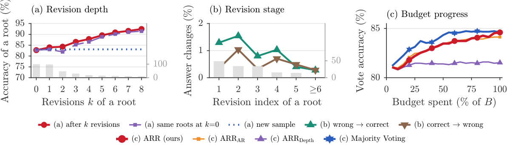
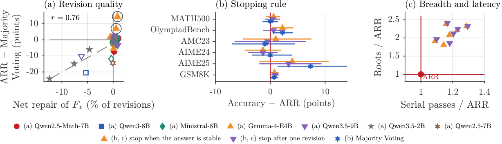
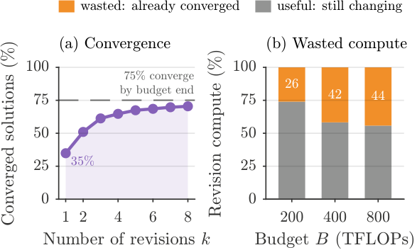

<div align="center">

# Adaptive Replay Refinement

### Allocating Test-Time Compute Between Revision and Resampling

*Official code of the paper (under anonymous review).*



</div>

**Should a model keep improving a solution, or stop and try a new one?**
Adaptive Replay Refinement (**ARR**) answers this question at inference time, without training.
ARR revises each sampled solution with one fixed greedy revision operator.
When a revision reproduces its input exactly, the solution is a **fixed point**: more revision cannot change it.
ARR then gives the compute of that solution to a **new independent sample**.
**Replay decoding** makes this test cheap: it uses the current solution as a draft and verifies its tokens in parallel.

- **Exact stop signal.** A fixed point is detected exactly. ARR has no confidence threshold, critic, tuned revision depth, or learned controller.
- **Short critical path.** Replay checks up to *W* = 32 reused tokens in one forward pass. On MATH500, ARR reaches 84.6% accuracy with 0.41 of the serial forward passes of majority voting.
- **Equal-compute comparison.** All methods share one FLOP account per question that charges every processed token: prompts, accepted and rejected draft tokens, and truncated calls.

---

## Contents

- [How ARR works](#how-arr-works)
- [Results](#results)
- [Installation](#installation)
- [Quick start](#quick-start)
- [Reproducing the paper](#reproducing-the-paper)
- [Methods](#methods)
- [Configuration](#configuration)
- [Outputs](#outputs)
- [Analysis and figures](#analysis-and-figures)
- [Repository structure](#repository-structure)
- [Citation](#citation)

---

## How ARR works

### 1. Replay decoding

ARR revises a solution *y* to the question *x* with greedy decoding of a fixed revision prompt, *F<sub>x</sub>(y) = Greedy(ρ(x, y))*.
A revision usually reproduces a long prefix of its input, so replay decoding uses *y* as a draft.
It checks *W* draft tokens in one parallel pass and accepts the longest prefix that matches the greedy predictions.
At the first disagreement it keeps the model's token, drops the rest of the draft, and continues with ordinary greedy decoding.
The output is **identical** to ordinary greedy decoding; only the number of serial passes changes.

<p align="center">
  
</p>

If the whole draft is accepted, termination token included, then *F<sub>x</sub>(y) = y*.
Because *ρ* depends only on *(x, y)* and greedy decoding is deterministic, every later revision also returns *y*: the root has reached a fixed point.
A fixed point of 512 tokens with *W* = 32 costs 17 serial passes instead of 513.

### 2. Fixed-point replacement

ARR keeps *N* = 4 active roots (solutions) and applies one rule to the revision *z* of each root:

| Revision *z* | Action |
|---|---|
| complete and different from *y* | *z* replaces *y*; revise again |
| identical to *y* (fixed point) | keep *y* as the root's final vote; sample a **new root** in its slot if the budget allows |
| truncated by the output cap or the budget | keep the last complete solution |

The prediction is the **majority vote** over one final answer per root.
Depth (revisions per root) and breadth (number of roots) adapt to each question with no tuned parameter.

<p align="center">
  
</p>

---

## Results

<p align="center">
  
</p>

<p align="center"><em>Accuracy against the median number of serial forward passes on the critical path (Qwen2.5-Math-7B-Instruct; each point is one budget B ∈ {200, 400, 800} TFLOPs per question).</em></p>

- **More accuracy per serial pass.** On MATH500, AMC23, and AIME24, ARR is above ARR<sub>AR</sub>, SETS, and Majority Voting over most of the latency range.
- **Equal FLOPs.** At *B* = 800, ARR and Majority Voting are equal within noise on MATH500, AMC23, and AIME24 (84.6% each on MATH500). Majority Voting is better on OlympiadBench, AIME25, and GSM8K.
- **Shorter critical path.** At *B* = 800, ARR needs 0.41–0.61 of the serial passes of Majority Voting at equal FLOPs, and writes 18.2k instead of 46.7k output tokens per MATH500 question.
- **Generality.** The method transfers to seven models from five families (Qwen2.5, Qwen3, Qwen3.5, Ministral, Gemma-4) and to LiveBench reasoning.

<details>
<summary><b>When should revision receive compute?</b></summary>

<p align="center"></p>

Most revisions converge quickly: 49% of first revisions are already fixed points, and the net repair of a revision falls to about zero after four revisions.
Revision helps when it repairs more answers than it breaks; otherwise independent samples are the better use of compute.

<p align="center"></p>

</details>

<details>
<summary><b>Motivation: revision exhausts after a few steps</b></summary>

<p align="center"></p>

On MATH500 most solutions reach a fixed point within a few revisions, so a fixed revision schedule spends much of its compute on solutions that can no longer change.

</details>

---

## Installation

The code needs Python ≥ 3.10, PyTorch, and Hugging Face Transformers. We ran every experiment on a single A100 or H100 GPU.

```bash
git clone <this-repository> arr && cd arr
uv sync                      # creates .venv from pyproject.toml / uv.lock
# or: python -m venv .venv && .venv/bin/pip install "torch>=2.4" "transformers>=4.57" accelerate datasets \
#     numpy sympy antlr4-python3-runtime==4.13.2 pyparsing
cp sample.env .env           # then edit the paths in .env
```

Gemma-4-E4B and Qwen3.5 need `transformers >= 5`. Install it in a second environment and set `TF5_VENV_PATH` in `.env`; the configs of these models use it.

---

## Quick start

```bash
# 1. CPU checks: graders, answer extraction, and on a tiny random model that replay
#    decoding equals greedy decoding, fixed points are detected, and budgets hold.
bash run_arr.sh sanity
python -m unittest tests/test_arr.py -v

# 2. ARR and every baseline on AIME 2024 with Qwen2.5-Math-7B-Instruct, B = 200, 400, 800 TFLOPs.
bash run_arr.sh run configs/arr_qwen_math_7b.conf,configs/arr_aime24.conf

# 3. Print the results table.
python parse_arr_results.py --dataset aime24
```

`run_arr.sh` sources `.env`, then the comma-separated config files in order, and calls `run_arr.py`.
Results are appended after each finished question, so the same command resumes an interrupted run.
On a Slurm cluster, `sbatch batch_arr.sh run <configs>` runs the same command on one GPU.

---

## Reproducing the paper

Each experiment is one model config plus one benchmark config, optionally followed by an ablation config.

| Experiment | Command |
|---|---|
| Main results, primary model | `bash run_arr.sh run configs/arr_qwen_math_7b.conf,configs/arr_<benchmark>.conf` |
| Benchmarks | `math500_all`, `olympiadbench`, `amc23`, `aime24`, `aime25`, `gsm8k`, `livebench` |
| Other models | `arr_qwen3_8b`, `arr_ministral_8b`, `arr_gemma4_e4b`, `arr_qwen35_9b`, `arr_qwen35_2b`, `arr_qwen_7b` (LiveBench) |
| More seeds | append `configs/arr_seed1.conf` (… `arr_seed4.conf`) |
| ConMA baseline | append `configs/arr_conma.conf` |
| Stopping-rule ablation | append `configs/arr_abl_stop.conf` |
| Width *N* | append `configs/arr_n2.conf` or `configs/arr_n8.conf` (with `arr_methods_nabl.conf`) |
| Block size *W* | append `configs/arr_w8.conf`, `arr_w16.conf`, or `arr_w64.conf` |
| Temperature | append `configs/arr_temp05.conf` or `configs/arr_temp10.conf` |
| Budget *B* = 1600 | append `configs/arr_budget1600.conf` |
| Revision prompt | append `configs/arr_revprompt1.conf` or `configs/arr_revprompt2.conf` |
| Latency-matched budgets | append `configs/arr_passes_budget.conf` |
| Wall-clock timing | append `configs/arr_timing.conf` (one solve at a time on an exclusive GPU) |

Write each ablation to its own output root, named after the main root with a suffix, so that `collect_results.py` reports it as a variant:

```bash
ARR_OUTPUT_ROOT=$PWD/.work/arr_results_n8 \
  bash run_arr.sh run configs/arr_qwen_math_7b.conf,configs/arr_math500_all.conf,configs/arr_methods_nabl.conf,configs/arr_n8.conf
```

Large benchmarks can be split over GPUs with `ARR_SHARD=i/n` (question index modulo *n*); the analysis merges the shards.

---

## Methods

Every method starts from the same *N* sampled roots, uses the same prompts, output cap, answer extraction, and majority vote, and spends the same FLOP budget *B*.

| Paper name | `ARR_METHODS` key | Update of a root | Stop / reallocation |
|---|---|---|---|
| **ARR** (ours) | `arr` | greedy revision, replay decoding | fixed point → new root |
| ARR<sub>AR</sub> | `replace_ordinary` | greedy revision, ordinary decoding | fixed point → new root |
| ARR<sub>PLD</sub> | `replace_pld` | greedy revision, prompt-lookup decoding | fixed point → new root |
| ARR<sub>Depth</sub> | `arr_no_replace` | greedy revision, replay decoding | fixed point → root retires, no new root |
| Self-Refine | `direct_fixed` | greedy revision | fixed depth *D* = 4 |
| SETS | `critic_correct` | critique, then correction | fixed point → new root |
| Sequential Revision | `continuation` | sampled continuation | until the budget ends |
| Majority Voting | `maj` | none (independent samples) | every sample → new root |
| ConMA | `conma` | confidence-guided kernel sampling | one answer left in the kernel |
| Ablation: answer stop | `arr_answer` | as ARR | extracted answer unchanged → new root |
| Ablation: one revision | `arr_once` | as ARR | after one revision → new root |

---

## Configuration

Settings are read in this order (later wins): defaults in `src/arr/config.py` < `.env` < config files < command-line flags `--<field>`.
Each field `foo_bar` is the environment variable `ARR_FOO_BAR`.

| Variable | Default | Meaning |
|---|---|---|
| `MODEL_NAME` | `Qwen/Qwen2.5-Math-7B-Instruct` | Hugging Face model |
| `ARR_METHODS` | all methods of the main table | comma-separated method keys |
| `ARR_DATASETS` | `aime24` | `math500`, `olympiadbench`, `amc23`, `aime24`, `aime25`, `gsm8k`, `livebench_reasoning` |
| `ARR_BUDGETS` | `200,400,800` | per-question budgets *B* |
| `ARR_COST_MEASURE` | `tflops` | `tflops` (FLOPs) or `passes` (serial forward passes) |
| `ARR_N_ACTIVE` | `4` | width *N*: number of active roots |
| `ARR_BLOCK_SIZE` | `32` | block size *W* of replay decoding (speed only, not output) |
| `ARR_MAX_NEW_TOKENS` | `1536` | output cap *T*<sub>max</sub> of every call |
| `ARR_TEMPERATURE`, `ARR_TOP_P` | `0.7`, `0.95` | sampling of new roots |
| `ARR_REVISE_PROMPT` | `0` | revision prompt *ρ* (0) or a paraphrase (1, 2) |
| `ARR_FIXED_DEPTH` | `4` | depth *D* of Self-Refine |
| `ARR_SEEDS`, `ARR_SEED_IDS` | `1`, all | number of seeds, or only some seed indices |
| `ARR_OUTPUT_ROOT` | `$SCRATCH/arr_results` | output directory |

---

## Outputs

```
$ARR_OUTPUT_ROOT/<model>/<dataset>/
├── config.json                      settings, checkpoint, chat template, engine facts
├── cohort/seed<k>.jsonl             the shared initial roots of every question
├── B<budget>/results_<method>.jsonl one record per question and seed: roots, revisions,
│                                    votes, answer, correctness, cost, serial passes, events
├── B<budget>/summary.json           metrics per method and paired comparisons with ARR
└── summary_all.json                 every budget and method in one table
```

Reported metrics include accuracy per seed, TFLOPs, serial passes on the critical path (median and p95), wall-clock latency, output tokens, roots and votes per question, fixed-point rate, accepted-prefix fraction, answers repaired and broken by revision, and paired question-level 95% confidence intervals.

---

## Analysis and figures

```bash
python parse_arr_results.py --markdown results/arr_results.md   # tables per model and benchmark
python collect_results.py            # results/all_results.{csv,html}: every cell of every output root
python arr_analysis.py               # results/analysis.json: dynamics, stopping rules, ablations, timing
python export_arr_figures.py         # figure-ready CSVs (Pareto fronts, trajectories, revisions)
python make_matlab_figure_script.py  # MATLAB scripts of the paper figures (values hard-coded)
python scripts/make_readme_assets.py # the two animations of this README
```

---

## Repository structure

```
.
├── run_arr.py                 entry point: sanity | pilot | run
├── run_arr.sh, batch_arr.sh   launcher (sources .env and configs) and a Slurm example
├── configs/                   models, benchmarks, seeds, and ablations
├── src/arr/
│   ├── engine.py              batched decoder: sample, greedy, replay, and PLD modes
│   ├── methods.py             controllers of ARR and the baselines (fixed-point replacement)
│   ├── conma.py               ConMA baseline
│   ├── ledger.py              per-question FLOP accounting under the budget B
│   ├── prompts.py             prompts of every method
│   ├── runner.py              experiment driver, resume, and metrics
│   ├── tasks.py, data.py      benchmarks: loading, answer extraction, scoring
│   ├── voting.py              answer normalization, majority vote, grader
│   ├── evaluators.py          dataset-specific graders
│   ├── stats.py               paired bootstrap and permutation tests
│   ├── sanity.py              CPU checks of the decoder and the graders
│   ├── math_toolkit/          LaTeX answer equivalence (third party, MIT)
│   └── benchmarks/            official LiveBench and NATURAL PLAN scorers (Apache-2.0)
├── tests/test_arr.py          unit tests (CPU, no download)
├── collect_results.py, arr_analysis.py, parse_arr_results.py, export_arr_figures.py
├── make_matlab_figure_script.py
├── scripts/make_readme_assets.py
└── assets/                    figures and animations of this README
```

---

## Citation

```bibtex
@inproceedings{arr2026,
  title     = {Adaptive Replay Refinement: Allocating Test-Time Compute Between Revision and Resampling},
  author    = {Anonymous},
  booktitle = {Under review},
  year      = {2026}
}
```

## Acknowledgements

`src/arr/math_toolkit` is adapted from Xwin-Math (MIT license), which builds on ToRA.
`src/arr/benchmarks` contains the official scorers of [LiveBench](https://github.com/LiveBench/LiveBench) and [NATURAL PLAN](https://github.com/google-deepmind/natural-plan) (Apache-2.0).
